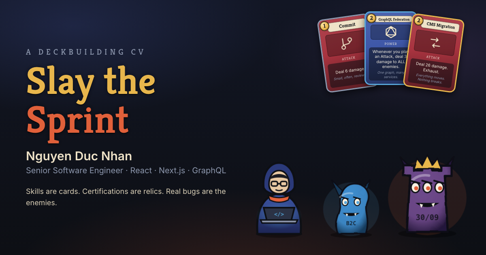
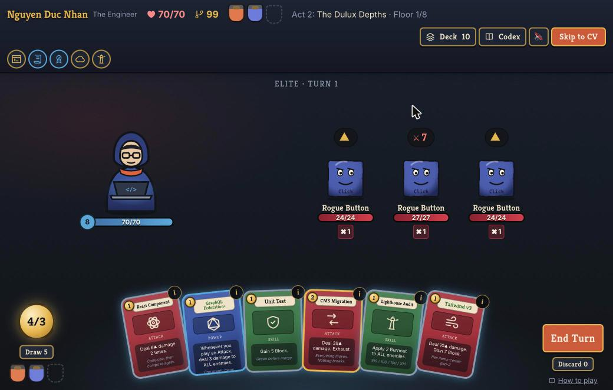

# Slay the Sprint

**A Slay the Spire–style deckbuilder that tells the career of [Nguyen Duc Nhan](https://www.linkedin.com/in/nhannd213/), Senior Software Engineer (React · Next.js · GraphQL), Hanoi.**

▶ **Play:** https://bigboobybear.github.io/slay-the-sprint/
📄 **Just the CV (no JavaScript needed):** https://bigboobybear.github.io/slay-the-sprint/cv/



Climb three Acts, one for each chapter of the career. Skills are **cards**, certifications are **relics**, AI tools are **potions**, and the enemies are real bugs, tickets and deadlines from production work. Every card, relic and enemy has an **Inspect** panel with the true story behind it. A run takes 10–15 minutes, and **Skip to CV** is always one click away.



## How the CV maps to the game

| Slay the Spire | Slay the Sprint | From the CV |
| --- | --- | --- |
| Act 1 | The Freelance Floors (2020–2022) | Rooms For Rent, Timesheet (Angular), Fintech Control Tower (React, D3), Scrum Master |
| Act 2 | The Dulux Depths (2022–2026) | dulux.com.au: 470+ merged PRs, sign-up flow, WCAG, SSR, Elasticsearch |
| Act 3 | The Migration Spire (2026) | Contentful → Optimizely CMS migration, Core Web Vitals, CSP, 18 CVEs |
| Bosses | Legacy Intern Codebase · Sign-up Hydra · Contentful Renewal Deadline | Real projects and the Sep 2026 renewal deadline |
| Cards | 36 skills: *Commit*, *Unit Test*, *GraphQL Federation*, *CMS Migration*… | Tech stack and ways of working |
| Relics | PSM I, AWS CCP, Google Educator, *470 Merged PRs*… | Certifications and milestones |
| Potions | Claude Code, Cursor, Copilot, Codex, Ollama… | AI tools |
| ? Events | "A Junior Is Stuck", "The BIM Request", "#OpenToWork"… | Episodes from the job |
| Ending | **The Offer**: contact links and the CV PDF | — |

## Engineering

- **Stack:** Vite 8, React 19, TypeScript (strict), Tailwind CSS v4, Zustand, Motion. All art is original inline SVG: line icons, a parametric "painterly" monster generator and the player character. Sound is synthesised with the Web Audio API (muted by default), so there are no asset files.
- **Engine:** a pure TypeScript reducer, `(state, action) → state`, with a seeded mulberry32 RNG (`src/engine`). It handles combat (energy, block, statuses, enemy intents, powers), StS-style map generation with non-crossing paths, rewards, the shop, rest sites, events and act transitions. Runs are deterministic, so any run can be replayed from its seed (`?seed=ABC`).
- **Content is data:** cards, enemies, relics, potions, events and acts live in `src/content`, each with a `cv` field. They are transcribed from one profile file that is the single source of truth.
- **Balance:** `pnpm simulate` runs a greedy bot through hundreds of seeded runs with the real reducer. Normal mode wins about 90% of runs; Story Mode wins 100%.
- **Recruiter-first:** `/cv/` is prerendered to static HTML at build time, with schema.org `Person` JSON-LD and print styles. Phone, date of birth and address never appear on the site.
- **Accessibility:** full keyboard play (`1–9`, `←/→`, `Enter`, `E`, `I`, `Esc`), an ARIA live combat log, labelled dialogs, `prefers-reduced-motion`, and AA contrast.
- **Performance:** first load is about 98 kB gzip. Motion's features load after first paint, the game and engine are lazy chunks prefetched in the background, and fonts are self-hosted.
- **Lighthouse (live site):** Accessibility, Best Practices and SEO are 100 on both pages. Performance is 100 on desktop and 92–99 on mobile.

```
src/
  content/   cards, enemies, relics, potions, events, acts, public profile
  engine/    types, rng, combat, map, run reducer (+ tests)
  store/     Zustand store over the reducer, crash-safe persistence
  ui/        art (SVG), components (Card, TopBar, overlays), screens
  cv/        CvPage (shared by /cv/ and the in-game overlay)
scripts/
  prerender-cv.ts   static /cv/ page at build time
  simulate.ts       balance bot
```

## Develop

```sh
pnpm install
pnpm dev          # http://localhost:5173/slay-the-sprint/
pnpm test         # 26 engine + integration tests (Vitest, Testing Library)
pnpm lint         # oxlint
pnpm build        # typecheck, production build, prerender /cv/
pnpm simulate --runs 500 [--story]
```

In dev, `window.__sts` has QA shortcuts: `__sts.jump('shop')`, `__sts.win()`, `__sts.lose()` and `__sts.act(3)`. They are never included in production builds.

**Deploy:** every push to `main` runs lint, tests and the build in GitHub Actions, then publishes to GitHub Pages. To serve from a user/org site or a custom domain, set `BASE_PATH=/` in the workflow and update the absolute URLs in `index.html` (`og:*`, canonical).

## Credits

A fan-made tribute to [Slay the Spire](https://www.megacrit.com/) by Mega Crit. It is not affiliated with or endorsed by Mega Crit and uses none of its art or assets. Fonts: Inter and Kreon (SIL Open Font License).
